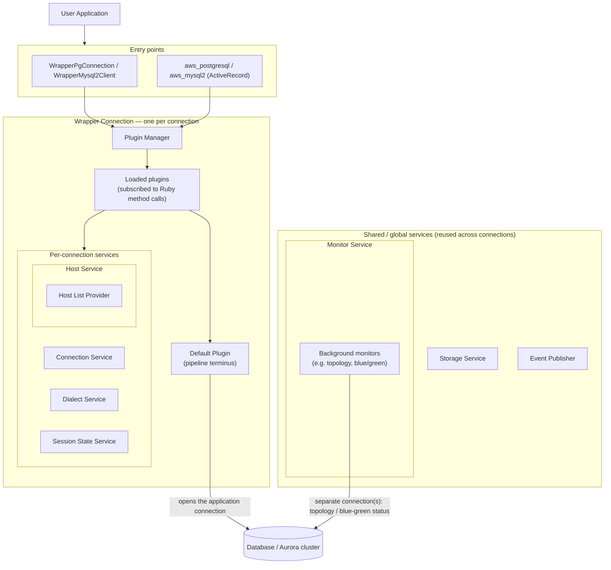

# Architecture

The diagram below shows what the AWS Advanced Ruby Driver Wrapper contains, which pieces are created per connection versus shared globally, and how a call flows from the user application down to the database.

The AWS Advanced Ruby Driver Wrapper contains 5 main components:

1. The connection entry points (`WrapperPgConnection`, `WrapperMysql2Client`, and the `aws_postgresql` / `aws_mysql2` ActiveRecord adapters)
2. The [plugin manager](./service-container#plugin-manager) (one of the services in the container)
3. The [loadable and extensible plugins](./loadable-plugins)
4. The [service container](./service-container) of discrete services
5. The host list providers

The connection entry points ensure all Ruby method calls are routed through the plugin manager.

The plugin manager handles all the loaded or registered plugins and sends the Ruby method call to be executed by all plugins [**subscribed**](./loadable-plugins#subscribed-methods) to that method.

During execution, plugins may utilize the [service container](./service-container) to help their execution by retrieving or updating:

- the current connection
- the hosts information
- topology of the database

:::note

- Each wrapper connection has its own instances of:
  - plugin manager
  - service container
  - loaded plugin classes
- Multiple wrapper connections opened to the same database server will have separate sets of instances mentioned above.
- The shared storage, monitor, and event-publisher services (and the host list provider) are reused across connections to the same database.

:::
