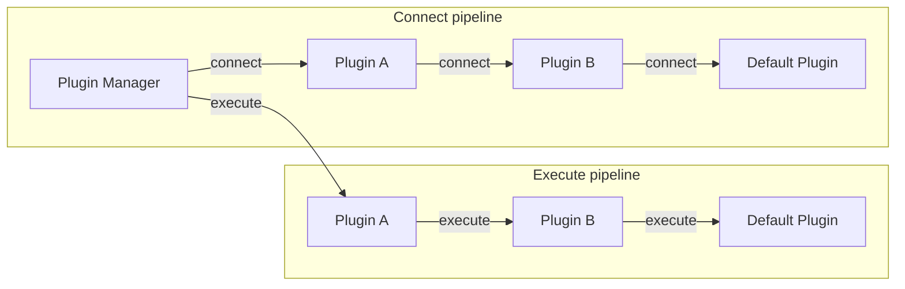

# Pipelines

A pipeline corresponds to a method that plugins can [subscribe](./loadable-plugins#subscribed-methods) to. Only the plugins subscribed to that pipeline take part in it — a call is routed left-to-right through each subscribed plugin and finally to `Default Plugin`, which performs the underlying work. Each plugin can run logic before and after handing off to the next plugin.

The diagram shows the **connect** and **execute** pipelines. `Plugin A` and `Plugin B` stand in for whichever plugins are subscribed to that pipeline; a given plugin only appears in the pipelines it actually subscribes to.

A plugin pipeline is an execution workflow achieving a specific goal.

The plugin pipelines available in the wrapper are:

- The connect pipeline.
- The internal_connect pipeline.
- The execute pipeline.

A plugin does not need to implement all pipelines. A plugin can implement one or more pipelines depending on its functionality.

For information on how to subscribe to these pipelines, please see the documentation on [subscribed methods](./loadable-plugins#subscribed-methods).

## Connect Pipeline

The connect pipeline performs any additional setup or post connection steps required to establish a connection. The connect pipeline is where a plugin runs setup around opening the connection your application uses.

The most common usage of the connect pipeline is to fetch extra credentials from external locations.

An example would be the IAM connection plugin. The IAM connection plugin generates an IAM authentication token to be used when establishing a connection. Since authentication is only required when establishing a connection and not required for any subsequent execution, the IAM authentication plugin only needs to implement the connect pipeline.

## Internal Connect Pipeline

The internal_connect pipeline opens a connection for the wrapper's own internal use — for example when a plugin needs a separate connection to a specific host during failover — rather than the connection handed back to your application. Plugins implement `internal_connect` when they need to control how these internal connections are established.

## Execute Pipeline

The execute pipeline performs additional work for Ruby method calls. This pipeline is not limited to query execution methods, it may be called for any methods such as `setTimeout` or `isValid`.

Usages for this pipeline include:

- handling execution exceptions
- logging and measuring execution information
- caching execution results
- updating the host lists before executing the method
- catching network exceptions and performing the failover procedure

## Release Resources / Shutdown

The AWS Advanced Ruby Driver Wrapper performs graceful shutdown through the `ShutdownService`
(a singleton) plus `at_exit` and `TERM`/`INT` signal traps installed in
`lib/aws_advanced_ruby_driver_wrapper.rb`. `release_resources` shuts down
the shared `MonitorService`, releases the `EventPublisher`, and clears
caches. Long-lived plugins/monitors register themselves as shutdown targets.
