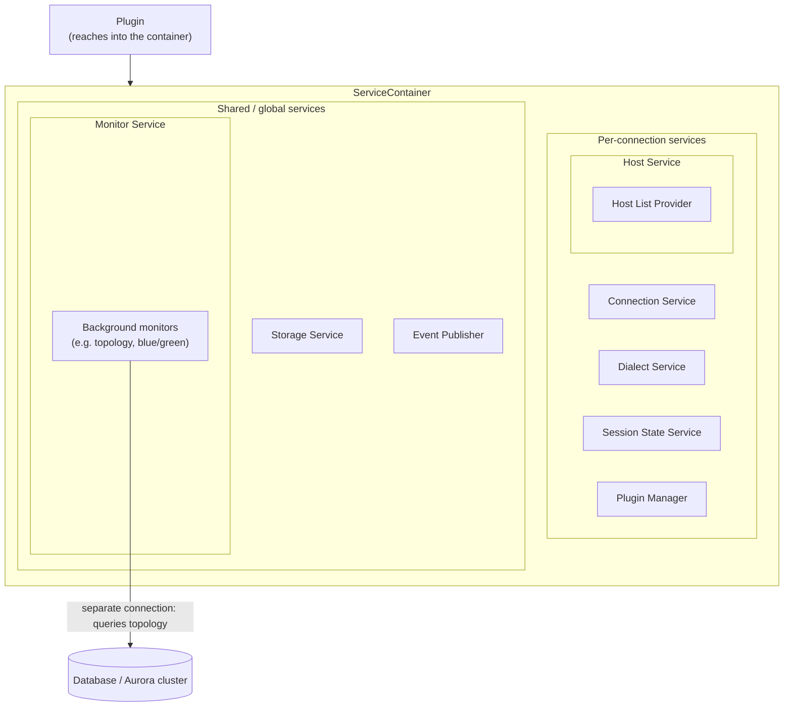

# Service Container

The `ServiceContainer` bundles the discrete services a plugin needs. A plugin reaches into the container to get the current connection, host/topology info, shared caches, background monitors, and events — instead of doing that work itself. Shared services are reused across connections; the rest are per-connection.



The AWS Advanced Ruby Driver Wrapper groups its internal capabilities into a **service container** — a bundle of discrete services that plugins reach into instead of doing the work themselves. It includes a plugin manager that drives the [pipelines](./pipelines), a service that tracks the current connection and host list, a storage service for shared caches, a monitor service for background monitors, and an event publisher.

The AWS Advanced Ruby Driver Wrapper uses a `ServiceContainer` — a `Struct`
holding discrete services — that is built once per wrapper connection. Every
plugin is constructed with `(service_container, props)` and reaches each
capability directly off the container, e.g. `service_container.host_service`
or `service_container.storage_service`.

The container holds these services: `connection_service`, `dialect_service`,
`host_service`, `session_state_service`, `plugin_manager`, `storage_service`,
`monitor_service`, and `event_publisher`.

```ruby
# Inside a plugin constructed with (service_container, props):
conn     = service_container.connection_service.current_connection
hosts    = service_container.host_service.hosts
dialect  = service_container.dialect_service.db_dialect
topology = service_container.storage_service.get(:topology, cluster_id)
```

## Available Services

### Connection Service

Tracks the current connection and its host, and switches the connection
during events like failover. It is the primary service for connection
state.

**Access:** `service_container.connection_service`

**What it offers**

- `current_connection` / `current_host_info` — the live connection and its host.
- `update_current_connection(connection, host_info)` — swap in a new connection.
- `config` — the parsed `ConnectionConfig`.

**When to use it**

Use it whenever a plugin needs the live connection or the current host, or to
replace the connection after selecting a new host.

### Host Service

Owns the host list and the host list provider, and resolves host-selection
strategies. See [Host List Providers](#host-list-providers).

**Access:** `service_container.host_service`

**What it offers**

- `hosts` / `all_hosts` — allowed and full host lists.
- `host_list_provider` — the active provider.
- `select_host(hosts, role, strategy, props = nil)` — pick a host by role and host-selection strategy name.
- `HostService.register_host_selector(name, selector)` — a class method that registers a custom strategy for all connections. Register the name in lowercase: `select_host` lowercases the requested strategy before looking it up.

**When to use it**

Use it to read topology, register a custom host-selection strategy, or pick a
host by role (writer/reader) and strategy.

### Dialect Service

Resolves and caches the database dialect (`db_dialect`) and the underlying
driver dialect (`driver_dialect`).

**Access:** `service_container.dialect_service`

**What it offers**

- `db_dialect` — the resolved database dialect (Aurora PG/MySQL, RDS, Multi-AZ, etc.).
- `driver_dialect` — the driver-level dialect (network-bound methods, etc.).

**When to use it**

Use it when behavior depends on the database/driver — for example the
`FailoverPlugin` subscribes to the dialect's network-bound methods.

### Session State Service

Tracks per-connection session state (transaction status, autocommit).

**Access:** `service_container.session_state_service`

**What it offers**

- `in_transaction?` / `autocommit?` — current session flags.
- `update_transaction_state(method_name, args, autocommit_before, dialect, connection, succeeded: true)` — fold a method call into the tracked state.
- `reset` — clear the tracked state, for example after the connection is replaced.

**When to use it**

Use it when a plugin needs to know whether the connection is inside a
transaction or in autocommit mode, for example to decide whether a failed
call can be retried transparently.

### Storage Service

A centralized cache registry of named partitions, each with its own TTL and
background cleanup thread. Shared across the wrapper.

**Access:** `service_container.storage_service`

**What it offers**

- `register(name, ttl:)` — create a named cache partition.
- `set(name, key, value)` / `get(name, key)` — store and read items.
- `get_if_registered(name, key)` — read a partition that may not exist (e.g. a cache owned by an optional plugin).
- `exists?(name, key)` / `remove(name, key)` / `clear(name)` / `clear_all`.

**When to use it**

Use it to cache data reused across the wrapper — for example the
`RdsHostListProvider` caches cluster topology here. Reads publish a
`DataAccessEvent` (unless `register_access: false`), which keeps related
monitors alive.

### Monitor Service

Manages background monitor lifecycle: registration, deduplication, expiration,
and cleanup. Subscribes to `DataAccessEvent` to extend monitor TTLs.

**Access:** `service_container.monitor_service`

**What it offers**

- `register_type(monitor_type, expiration_timeout_sec:, produced_data_type:)` — declare a monitor type.
- `run_if_absent(monitor_type, key, service_container) { ... }` — start once, then reuse.
- `get(...)` / `stop_and_remove(...)` — look up or stop a monitor.

**When to use it**

Use it for shared background work — for example the `RdsHostListProvider`
lazily starts a `ClusterTopologyMonitor` that caches topology in the Storage
Service. Monitors that produce a `produced_data_type` have their expiry
extended whenever that data is read.

### Event Publisher

A `BatchingEventPublisher` — a publish/subscribe bus that delivers immediate
events synchronously and batches the rest, deduplicating via `Set` semantics.

**Access:** `service_container.event_publisher`

**What it offers**

- `subscribe(subscriber, event_classes)` / `unsubscribe(...)`.
- `publish(event)` — immediate delivery or batched by `immediate_delivery?`.
- `release_resources` — stop the background publishing thread.

**When to use it**

Use it to decouple event producers and consumers. For example the Storage
Service publishes a `DataAccessEvent` on cache reads, and the Monitor Service
subscribes to it to extend the matching monitor's expiration.

### Plugin Manager

The plugin manager has the following main functionalities:

- Load and initialize plugins
- Initiate [pipelines](./pipelines)

#### Load and Initialize Plugins

The plugin manager initializes all plugins registered via the `wrapper_plugins` connection parameter.

#### Initiate Pipelines

During the initial connection phase, the host list provider is set up for the connection (from the resolved database dialect), and then the initial connection runs through the connect pipeline. The host list provider is then used by all the plugins. See [Pipelines](./pipelines) for how a call flows through the plugins.

All subsequent Ruby method calls will trigger the execute pipeline.

#### Plugin ordering

Plugins are ordered by a fixed weight (lower runs first / outermost). The
built-in weights are: Blue/Green `200`, Custom Endpoint `250`, Initial
Connection Strategy `300`, Failover `400`, GDB Failover `500`, IAM `1800`,
Secrets Manager `1900`, KMS Encryption `2050`. `load_plugins` reads the `wrapper_plugins` list,
sorts by weight, instantiates each with `(service_container, props)`, and
**always appends `DefaultPlugin` last** — it is the pipeline terminus that
actually opens the underlying driver connection.

:::note

The pipeline is built lazily per method and memoized. The subscribed
plugins are folded right-to-left into nested lambdas, so each plugin can run
code before and after `next_plugin.call`.

:::

## Host List Providers

Plugins should not track host information themselves. Instead, the service container uses a **host list provider** to retrieve the most recent host or topology information about the database, and notifies it to refresh when needed.

The AWS Advanced Ruby Driver Wrapper has two host list providers, the `ConnectionStringHostListProvider` and the `RdsHostListProvider`.

The `RdsHostListProvider` provides information about the Aurora cluster. It uses an internal monitoring connection to track the available hosts and their roles in the cluster.

The `ConnectionStringHostListProvider` is a static host list provider, whereas the `RdsHostListProvider` is a dynamic host list provider. A static host list provider will fetch the host list during initialization and does not update the host list afterwards, whereas a dynamic host list provider will update the host list information based on database status.

Which provider is used is decided by the resolved database dialect, not by the raw URL. The `ConnectionStringHostListProvider` is used for the non-cluster dialects (`pg`, `mysql`, `rds-pg`, `rds-mysql`), whereas the dynamic `RdsHostListProvider` is used for the cluster dialects; it lazily starts a `ClusterTopologyMonitor` (via the shared `MonitorService`) that caches topology in the `StorageService`. Aurora Global Database dialects use `GlobalAuroraHostListProvider`, a topology-aware variant of `RdsHostListProvider`.
The dialect codes that select the dynamic, topology-aware provider are:

- `aurora-pg` / `aurora-mysql` — Aurora clusters
- `global-aurora-pg` / `global-aurora-mysql` — Aurora Global Databases
- `multi-az-pg-cluster` / `multi-az-mysql-cluster` — RDS Multi-AZ DB clusters

Because the dialect is refined after the first connection, connecting to an **instance** endpoint of one of these clusters starts out on the `ConnectionStringHostListProvider` and is then upgraded to the topology-aware provider once the wrapper queries the server and detects the cluster dialect on that first connect. To skip that detection step and use the topology-aware provider immediately, set the database dialect explicitly with the dialect connection parameter.
