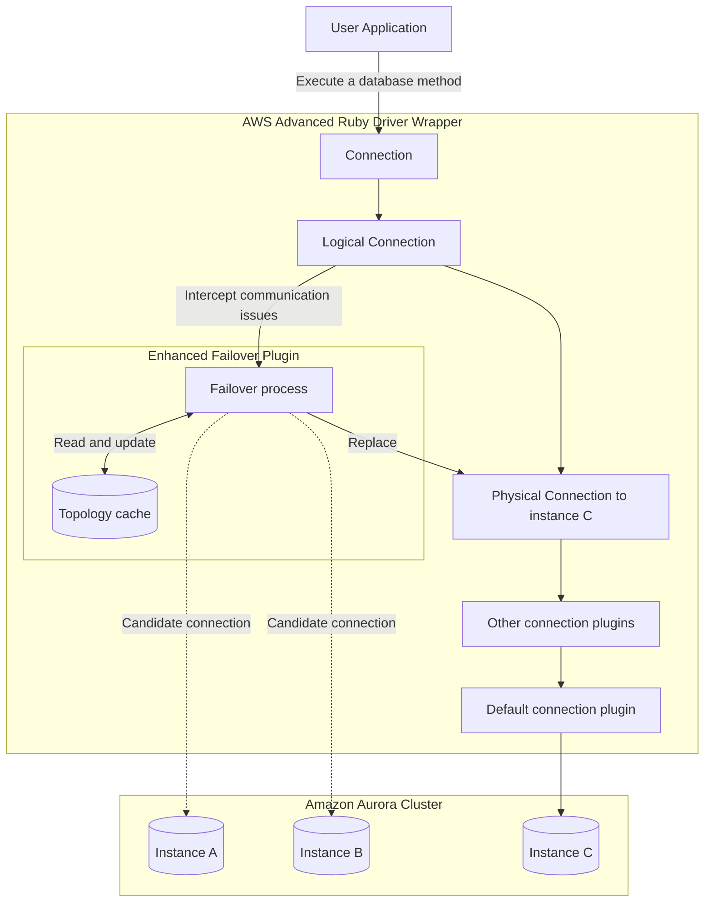

In an Amazon Aurora database (DB) cluster, [**failover**](https://docs.aws.amazon.com/AmazonRDS/latest/AuroraUserGuide/aurora-failover.html) is the mechanism by which Aurora repairs cluster availability when a primary DB instance becomes unavailable. Aurora elects an Aurora Replica to become the new primary DB instance. The AWS Advanced Ruby Driver Wrapper uses the **Enhanced Failover Plugin** to detect the topology change and reconnect with minimal downtime.

A connection returned by the wrapper is logical: the underlying physical connection is connected to one DB instance, but the application does not need to manage that instance directly. When the instance fails, Aurora starts its failover and the wrapper intercepts the resulting communication error. The wrapper discovers an available instance, reconnects the physical connection, and signals the application so it can reconfigure session state and replay work as needed.



*The application holds a logical connection. The physical connection points at instance C, and the plugin replaces it with a candidate instance when C fails. Solid arrows are the current physical connection; dashed arrows are candidate connections.*

:::info Available since
1.0.0 (default plugin)
:::

## How the enhanced failover process works

The host list provider delegates topology discovery to a cluster topology monitor that runs in its own thread, one per cluster, rather than repeating the work on each connection's failover path. Connections that encounter a communication error request a refresh and wait while the monitor detects and confirms the new writer. Once the topology is available, all waiting connections can resume and reconnect:

```mermaid
%%{init: {'theme':'base','gantt':{'displayMode':'compact','barHeight':22,'barGap':26,'topPadding':55,'leftPadding':185},'themeVariables':{'sectionBkgColor':'#ffffff','altSectionBkgColor':'#fafafa','gridColor':'#dddddd','doneTaskBkgColor':'#f2f2f2','doneTaskBorderColor':'#9e9e9e','critBkgColor':'#e03131','critBorderColor':'#a61e1e','activeTaskBkgColor':'#f7cfd0','activeTaskBorderColor':'#c98d90','taskBkgColor':'#8cc68c','taskBorderColor':'#3f7f3f','taskTextColor':'#1b1b1b','taskTextDarkColor':'#1b1b1b','taskTextLightColor':'#1b1b1b','taskTextOutsideColor':'#1b1b1b'}}}%%
gantt
  title Connections wait while one monitor detects the new writer
  dateFormat HH:mm:ss
  axisFormat %S
  tickInterval 5second
  todayMarker off

  section Connection 1
  Normal workload :done, e1a, 00:00:00, 00:00:05
  Error detected :crit, e1b, 00:00:05, 00:00:09
  Wait :active, e1c, 00:00:09, 00:00:18
  Connect to a new writer : e1d, 00:00:18, 00:00:25
  Normal workload :done, e1e, 00:00:25, 00:00:32

  section Connection 2
  Normal workload :done, e2a, 00:00:00, 00:00:09
  Error detected :crit, e2b, 00:00:09, 00:00:13
  Wait :active, e2c, 00:00:13, 00:00:18
  Connect to a new writer : e2d, 00:00:18, 00:00:25
  Normal workload :done, e2e, 00:00:25, 00:00:32

  section Topology monitor
  Slow rate monitoring :done, m1, 00:00:00, 00:00:09
  Detecting a writer : m2, 00:00:09, 00:00:18
  High rate monitoring : m3, 00:00:18, 00:00:32
```



*Connections request a topology refresh and suspend. The topology monitor (`ClusterTopologyMonitor`) detects the new writer, notifies every waiting connection at once, and then keeps monitoring at the high rate. Relative time, not to scale.*

The monitor normally refreshes topology at a slow rate. During writer discovery it can enter a high-rate period, which typically also continues for 30 seconds after a new writer is detected, so that readers have time to return to the topology. This reduces duplicate work, allows multiple connections to share the result, and scales better when several connections fail together.

The monitor normally prefers a writer connection because a writer provides a current view of cluster topology. In exceptional cases it may temporarily use a reader, but it returns to a writer as soon as possible. Topology learned from a reader can be stale briefly after a failover.

When the topology must be confirmed, the monitor probes cluster instances in parallel and asks each connection whether it is a writer. It stops the probes when a writer is found. Reader results can also contribute to a stable topology before the monitor reports the refreshed topology:

```mermaid
%%{init: {'theme':'base','gantt':{'displayMode':'compact','barHeight':22,'barGap':26,'topPadding':55,'leftPadding':185},'themeVariables':{'sectionBkgColor':'#ffffff','altSectionBkgColor':'#fafafa','gridColor':'#dddddd','doneTaskBkgColor':'#fdeccd','doneTaskBorderColor':'#dfae5a','critBkgColor':'#e03131','critBorderColor':'#a61e1e','activeTaskBkgColor':'#d4ead4','activeTaskBorderColor':'#7fae7f','taskBkgColor':'#e6dcf5','taskBorderColor':'#a58fd0','taskTextColor':'#1b1b1b','taskTextDarkColor':'#1b1b1b','taskTextLightColor':'#1b1b1b','taskTextOutsideColor':'#1b1b1b'}}}%%
gantt
  title The monitor probes every instance in parallel to confirm the writer
  dateFormat HH:mm:ss
  axisFormat %S
  tickInterval 5second
  todayMarker off

  section Instance-1 (new writer)
  connecting :done, i1a, 00:00:00, 00:00:10
  Am I writer? - Yes! :active, i1b, 00:00:11, 00:00:16
  Reported topology : i1c, 00:00:16, 00:00:21

  section Instance-2 (reader)
  connecting :done, i2a, 00:00:00, 00:00:04
  Am I writer? - No :active, i2b, 00:00:05, 00:00:10
  Topology - writer changed! : i2c, 00:00:10, 00:00:17

  section Instance-3 (old writer)
  connecting :done, i3a, 00:00:00, 00:00:09
  Am I writer? - No :active, i3b, 00:00:10, 00:00:15
  Stale topology : i3c, 00:00:15, 00:00:20

  section Main monitoring thread
  Notified about new instances :milestone, n1, 00:00:10, 0s
  Confirmed topology reported :milestone, n2, 00:00:21, 0s
```



*Each instance monitor connects and checks its own role, so the monitor never depends on a reader's topology view. Instance-1 answers yes and reports `instance-1 (W), instance-2 (R), instance-3 (R)`. Instance-2 answers no and reports that the writer changed. Instance-3, the old writer, still reports `instance-3 (W)` — the stale reading the direct role check avoids. Relative time, not to scale.*

This direct role check avoids relying solely on a reader's potentially stale topology information. The monitor stops unnecessary instance probes after a writer is confirmed and continues topology updates at the high refresh rate while the cluster stabilizes.

## How to enable

When `wrapper_plugins` is not specified, the wrapper loads `failover,initial_connection`, so the `failover` plugin is enabled by default. The `failover` plugin is the enhanced implementation described on this page. To select it explicitly, include `failover` in `wrapper_plugins`. Setting `wrapper_plugins` replaces the default list, so also list `initial_connection` if you want to keep it.

```ruby
require 'aws_advanced_ruby_driver_wrapper/postgresql'

conn = AwsAdvancedRubyDriverWrapper::WrapperPgConnection.new(
  host: "my-cluster.cluster-xyz.us-east-1.rds.amazonaws.com",
  dbname: "mydb",
  user: "<username>",
  password: "<password>",
  wrapper_plugins: "failover",
  failover_timeout_sec: 300.0 # seconds
)

```

Verify plugin compatibility within your Ruby configuration using the [compatibility guide](./compatibility).

:::warning
Only one failover plugin may be enabled per connection. Do not use `failover` together with the other `gdb_failover` plugin at the same time for the same connection. Configuring more than one raises a `PluginConflictError` at connection initialization.
:::

## Enhanced failover parameters

In addition to parameters for the underlying database driver, configure the following Ruby properties to control enhanced failover behavior. Units and parameter spelling are wrapper-specific.

| Parameter | Type | Required | Default | Description |
|-----------|------|----------|---------|-------------|
| `failover_mode` | String | No | depends on URL | Defines the target role during failover: `strict_writer`, `reader_or_writer`, or `strict_reader`. A read-only cluster endpoint defaults to `reader_or_writer`; other URLs default to `strict_writer`. |
| `cluster_instance_host_pattern` | String | Required for IP addresses and custom domains; otherwise No | auto-derived for recognizable RDS endpoints | Pattern used to build instance endpoints when the connection host is not a recognizable RDS endpoint. Use `?` as the instance identifier placeholder. |
| `cluster_topology_refresh_rate_sec` | Float | No | `5.0` | Regular interval at which the topology monitor refreshes the cluster when it is stable. *(sec)* |
| `failover_timeout_sec` | Float | No | `300.0` | Maximum time allowed to reconnect to a new writer or reader after failover starts. *(sec)* |
| `cluster_topology_high_refresh_rate_sec` | Float | No | `0.1` | Interval between topology updates during the high-rate period after a new writer is detected. *(sec)* |
| `cluster_topology_max_instance_monitors` | Integer | No | `16` | Maximum number of per-instance topology monitors run in parallel during a topology update. When the cluster has more instances than this, only the first that many are monitored concurrently. |
| `failover_reader_host_selector_strategy` | String | No | `random` | Strategy used to select a reader node during reader failover. |
| `cluster_id` | String | Required when one application uses multiple clusters; otherwise No | `1` | Unique identifier for a cluster. Connections with the same identifier share one topology monitor and cache; different clusters must use different identifiers. |
| `enable_connect_failover` | Boolean | No | `false` | Enables cluster-aware failover when the initial connection fails because of a network exception. The initial connection may be redirected to another instance. |

### Host pattern

When connecting through an IP address, CNAME, custom domain, or another endpoint that does not contain a recognizable RDS instance pattern, set `cluster_instance_host_pattern`. Use `?` as the placeholder for the DB instance identifier. For example, if instance endpoints follow `instanceIdentifier.customHost`, use `?.customHost` as the pattern. The wrapper uses this pattern to build per-instance endpoints while it discovers topology.

:::warning
When using a CNAME or custom domain, set both the instance host pattern and the cluster identifier. Without the pattern, topology discovery cannot construct resolvable per-instance hostnames.
:::

### Configuring topology-monitoring connections

The topology monitor opens its own connections to query topology and verify the writer. To apply connection-specific settings, prefix the setting with `topology_monitoring_`. This lets you use shorter timeouts for monitor connections than for application connections, preventing an unavailable node from blocking topology discovery indefinitely.

```ruby
conn = AwsAdvancedRubyDriverWrapper::WrapperPgConnection.new(
  host: "my-cluster.cluster-xyz.us-east-1.rds.amazonaws.com",
  dbname: "mydb",
  user: "<username>",
  password: "<password>",
  wrapper_plugins: "failover",
  # The prefix is stripped and the setting is passed to the underlying driver, so use
  # an option the driver accepts (e.g. pg: keepalives_idle; mysql2: read_timeout).
  topology_monitoring_connect_timeout: 10
)

```

The monitor is shared once per `cluster_id`, and the first connection that creates it supplies the monitor's connection context. Connections that share a cluster identifier therefore share the monitor and its database context. For details on monitor sharing and multi-connection scenarios, see [Cluster ID](./cluster-id).

The topology monitor uses the prefixed driver and wrapper properties to build its monitoring connection. The monitor uses the same cluster topology cache for all connections that share the cluster identifier.

## Failover errors

When failover occurs, the AWS Advanced Ruby Driver Wrapper signals the outcome by raising
a specific **error class**.

| Error class | Connection valid? | Reusable? | What to do |
|---|:---:|:---:|---|
| `FailoverFailedError` | No | No | Failover could not find a new instance. Wait until the server is available, then reconnect. |
| `FailoverSuccessError` | Yes | Yes | Failover succeeded outside a transaction. Reconfigure session state, then replay the last statement. |
| `TransactionStateUnknownError` | Yes | Yes | Failover happened inside a transaction. Reconfigure session state, restart the transaction, replay all its statements. |

### FailoverFailedError

The original connection failed, and the wrapper could not reconnect to a new instance before the failover attempt ended. Wait until the server is available, then reconnect.

### FailoverSuccessError

Failover succeeded outside a transaction. Session state from the original connection is lost. Reuse the connection, reconfigure its session state, and replay the statement that was interrupted.

### TransactionStateUnknownError

Failover happened inside a transaction. The wrapper cannot tell whether the transaction completed, so the outcome must be treated as unknown. Reuse and reconfigure the connection, restart the transaction, and replay all statements in it.

:::caution Do not dispose the connection on failover errors
The wrapper establishes a new internal connection before raising the error, and reuses the
same connection object rather than replacing it. If you close or discard the connection
object when handling the error, you lose that ready-to-use connection. Check the error type
first and reuse the connection when failover succeeded.
:::

:::note Using the wrapper through ActiveRecord
When you use the wrapper through ActiveRecord (`aws_postgresql` or `aws_mysql2`),
reconnection is partially handled for you. On a successful failover the adapter
re-runs `configure_connection` and reuses the pooled connection in place rather than
discarding it, so you should not call `disconnect!` or discard the connection object
yourself — the pool already holds the live, reconnected connection.
:::

## ActiveRecord integration

When using the wrapper through ActiveRecord (`aws_postgresql` or `aws_mysql2`), the
adapter's `translate_exception` decides what your code actually rescues, and the
outcome differs by error:

- **`FailoverSuccessError`** — failover succeeded outside a transaction. The adapter
  re-runs `configure_connection` and then re-raises this error **unchanged**, so your
  `rescue` sees `AwsAdvancedRubyDriverWrapper::Errors::FailoverSuccessError`, not an
  ActiveRecord error. The connection is live and pointed at the new writer; replay the
  work.
- **`TransactionStateUnknownError`** — failover succeeded while a transaction was open.
  Handled the same way, and also re-raised unchanged. The transaction's outcome is
  genuinely unknown, so check before retrying anything that is not idempotent.
- **`FailoverFailedError`** — failover could not reach a writer in time. Only this one
  is translated, into `ActiveRecord::ConnectionFailed`, carrying the original error as
  its message. In your logs it appears as a single wrapped line:

```text
ActiveRecord::ConnectionFailed: AwsAdvancedRubyDriverWrapper::Errors::FailoverFailedError: Unable to connect to a writer instance
```

Seeing `ActiveRecord::ConnectionFailed` therefore means failover **failed**, not that
it succeeded. The adapter marks the connection broken, so `active?` returns `false` and
ActiveRecord discards it and opens a fresh one on the next checkout. Do not rescue and
discard the connection yourself.

The AWS Advanced Ruby Driver Wrapper's `SessionStateService` tracks transaction and
autocommit state but does not transfer every session setting across a failover.
`configure_connection` restores what ActiveRecord itself configures; anything else your
application depends on — search path, timezone, prepared statements — is yours to
re-apply before replaying work.

## Re-applying session state automatically after failover

ActiveRecord runs its adapter's `configure_connection` step whenever it configures a
connection — including immediately after a successful failover, because the adapter
calls `configure_connection` while handling `FailoverSuccessError` and
`TransactionStateUnknownError`. `configure_connection` applies the session variables you
declare through the adapter's `variables:` option, so any `SET`-style session state
listed there is re-applied to the new connection on failover without extra code:

```yaml
# config/database.yml
production:
  adapter: aws_postgresql
  host: my-cluster.cluster-xyz.us-east-1.rds.amazonaws.com
  database: mydb
  username: <username>
  password: <password>
  wrapper_plugins: failover
  variables:
    statement_timeout: 5000
    timezone: "UTC"
```

Put the session settings your application relies on under `variables:`. Because the
pooled connection object is preserved across failover (the adapter reconnects it in
place rather than discarding it), and `configure_connection` re-runs on the new writer,
those variables are restored automatically. Session state that is *not* expressed as a
`variables:` entry — for example prepared statements, temporary tables, or advisory
locks — is still yours to re-establish before replaying work.
