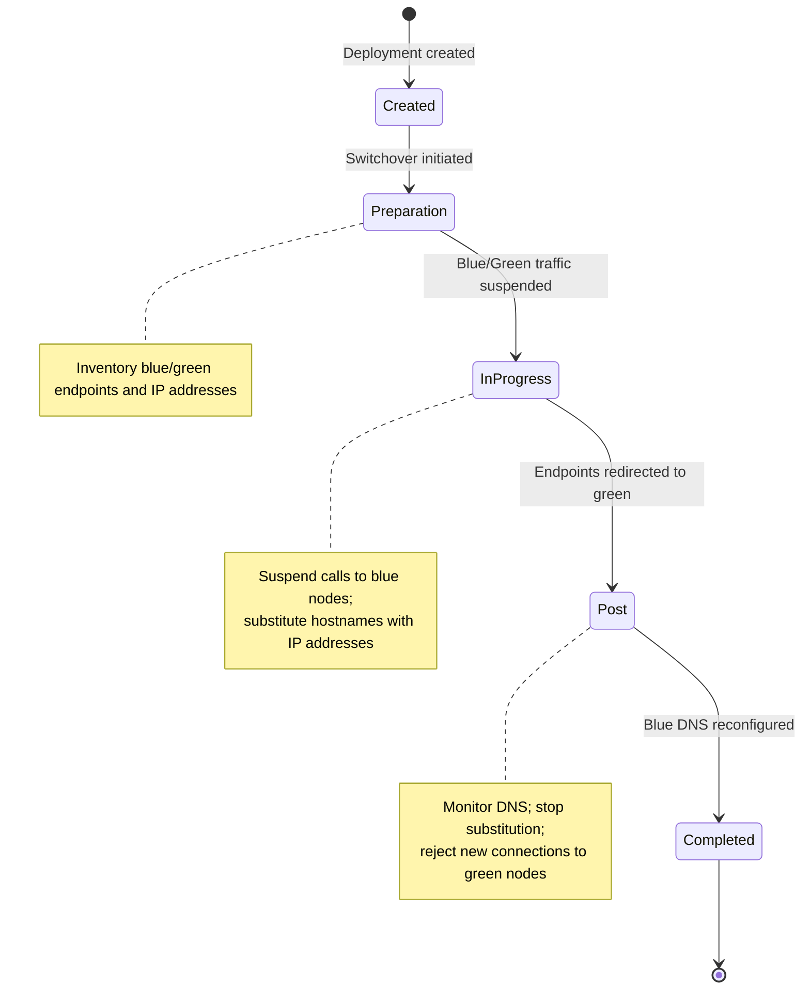

The [Blue/Green Deployment](https://docs.aws.amazon.com/whitepapers/latest/blue-green-deployments/introduction.html)
technique releases changes by shifting traffic between two identical
environments running different versions, reducing downtime and rollback risk.
During an
[RDS/Aurora Blue/Green switchover](https://docs.aws.amazon.com/AmazonRDS/latest/UserGuide/blue-green-deployments-switching.html),
connections to blue nodes terminate, endpoints are redirected, internal node
names change, and certificates are regenerated — all of which can disrupt an
application.

The Blue/Green Deployment Plugin minimizes that disruption by actively monitoring
switchover status and adjusting connection handling at each phase:

- **Before the switchover**, it inventories the blue and green endpoints and their IP addresses.
- **During the active switchover**, it temporarily suspends calls to blue nodes and substitutes hostnames with the corresponding IP addresses to avoid stale DNS.
- **After the switchover**, it monitors DNS until blue endpoints are reconfigured, then stops substituting.
- **Once switchover completes**, it rejects new connections to green nodes.
- **If the switchover fails or rolls back**, it detects that and restores normal handling.


:::info Available since
Version 1.0.0
:::

:::warning
**Currently supported deployments:**
- Aurora MySQL and PostgreSQL clusters
- RDS MySQL and PostgreSQL instances

**Unsupported deployments and configurations:**
- RDS MySQL and PostgreSQL Multi-AZ clusters
- Aurora Global Database for MySQL and PostgreSQL
- Connecting to database nodes using CNAME aliases

Full Blue/Green support also requires a minimum database engine version that includes
a specific metadata table (and, on RDS PostgreSQL, the `rds_tools` extension). If the
version does not include it, the plugin detects its absence and falls back to its
previous behavior — no action required. See
[Known limitation](#known-limitation) below for the minimum versions and setup.

:::



*The plugin tracks the switchover through these phases. During the active phase it holds new blue connections and substitutes IP addresses to avoid stale DNS; after the switchover it monitors DNS until blue endpoints are reconfigured, then resumes normal handling. A detected failure or rollback returns the deployment to normal handling.*

## How to enable

Add the plugin code `bg` to the `wrapper_plugins` parameter.

```ruby
conn = AwsAdvancedRubyDriverWrapper::WrapperPgConnection.new(
  host: "my-cluster.cluster-xyz.us-east-1.rds.amazonaws.com",
  dbname: "mydb",
  wrapper_plugins: "bg"
)

```

## Configuration parameters

| Parameter | Type | Required | Default | Description |
|-----------|------|----------|---------|-------------|
| `bgd_id` | String | Yes for multiple deployments; otherwise No | `1` | Identifier that distinguishes different Blue/Green Deployments. Required when supporting multiple deployments: all connection strings for the same deployment must share the same value, and different deployments must use distinct values.<br/><br/>Example: `abc-1` |
| `bg_connect_timeout_sec` | Float | No | `30.0` | Maximum waiting time for establishing new connections during a switchover while blue and green traffic is temporarily suspended. *(sec)*<br/><br/>Example: `30.0` |
| `bg_baseline_sec` | Float | No | `60.0` | Baseline interval for checking Blue/Green Deployment status. Keep this below 900 sec (15 minutes). *(sec)*<br/><br/>Example: `60.0` |
| `bg_increased_sec` | Float | No | `1.0` | Increased interval for checking Blue/Green Deployment status. Configure within 0.5–2 sec. *(sec)*<br/><br/>Example: `1.0` |
| `bg_high_sec` | Float | No | `0.1` | High-frequency interval for checking Blue/Green Deployment status. Configure within 0.05–0.5 sec. *(sec)*<br/><br/>Example: `0.1` |
| `bg_switchover_timeout_sec` | Float | No | `180.0` | Maximum duration allowed for switchover completion. If the process stalls or exceeds this, the wrapper assumes completion and resumes normal operations. *(sec)*<br/><br/>Example: `180.0` |

## Configuring monitoring connections

The plugin establishes dedicated monitoring connections to track Blue/Green Deployment status. To apply specific settings to these monitoring connections, prefix any configuration parameter with `bg_monitoring_`:

```ruby
conn = AwsAdvancedRubyDriverWrapper::WrapperPgConnection.new(
  host: "my-cluster.cluster-xyz.us-east-1.rds.amazonaws.com",
  dbname: "mydb",
  wrapper_plugins: "bg",
  bg_monitoring_connect_timeout: 10,
  bg_monitoring_socket_timeout: 10
)

```

## Known limitation

Full Blue/Green support requires a minimum database engine version that includes
a specific metadata table. When the green deployment meets the minimum version,
the metadata is available and the plugin uses its enhanced handling; otherwise
the plugin automatically detects the table's absence and falls back to its
previous behavior, subject to the limitations listed above. No action is required
for that fallback. This version constraint does **not** apply to RDS MySQL.

For RDS PostgreSQL you must also install the `rds_tools` extension so the
metadata is exposed:

```sql
CREATE EXTENSION rds_tools;
```

Minimum engine versions that include the metadata table:

| Engine              | Minimum version                                                            |
|---------------------|----------------------------------------------------------------------------|
| Aurora PostgreSQL   | Engine release `17.5`, `16.9`, `15.13`, `14.18`, `13.21`, or above         |
| Aurora MySQL        | Engine release `3.07` or above                                             |
| RDS PostgreSQL      | `rds_tools v1.7` (`17.1`, `16.5`, `15.9`, `14.14`, `13.17`, `12.21`) or above |
| RDS MySQL           | No metadata-table version requirement                                      |

Aurora PostgreSQL clusters running engine release `17.7, 16.11, 15.15, 14.20,
13.23` or above experience shorter switchover downtime than earlier versions
(following the source/blue cluster's engine version).

