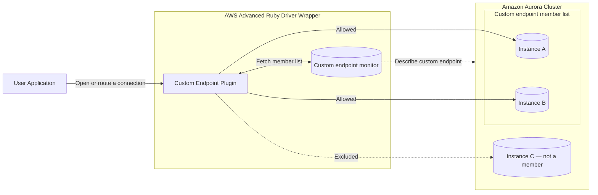

The Custom Endpoint Plugin adds support for
[Aurora custom endpoints](https://docs.aws.amazon.com/AmazonRDS/latest/AuroraUserGuide/Aurora.Endpoints.Custom.html).
When the plugin is in use, the wrapper analyzes the custom endpoint's member
list to ensure the instances used for connections are part of the custom
endpoint being used, including connections used during failover. Use this
plugin when your connection host is an Aurora cluster custom endpoint:
`<custom-endpoint-name>.cluster-custom-<XYZ>.<region>.rds.amazonaws.com`.


:::note
An Aurora custom endpoint is a cluster endpoint with a user-defined member
list, managed in RDS. It is **not** the same as a user custom domain (a CNAME
alias pointing at an RDS endpoint), which is configured with the instance host
pattern parameter instead.

:::

:::info Available since
Version 1.0.0
:::



*The plugin keeps a cached view of the custom endpoint's member list, refreshed by a background monitor. Connections — including those opened during failover — are restricted to instances in the member list; instances outside it are excluded.*

## How to enable

1. If needed, [create a custom endpoint](https://docs.aws.amazon.com/AmazonRDS/latest/AuroraUserGuide/aurora-custom-endpoint-creating.html) using the RDS Console.
2. Add the plugin code `custom_endpoint` to the `wrapper_plugins` parameter.
3. Specify any parameters required for your case.

```ruby
conn = AwsAdvancedRubyDriverWrapper::WrapperPgConnection.new(
  host: "my-endpoint.cluster-custom-xyz.us-east-1.rds.amazonaws.com",
  dbname: "mydb",
  wrapper_plugins: "custom_endpoint"
)

```

Verify plugin compatibility within your Ruby configuration using the [compatibility guide](../compatibility).

## Configuration parameters

| Parameter | Type | Required | Default | Description |
|-----------|------|----------|---------|-------------|
| `custom_endpoint_region` | String | Required for IP addresses and custom CNAMEs; otherwise No | parsed from URL | The region of the cluster's custom endpoints. Parsed from the URL when not specified, and required for endpoints that carry no region — IP addresses and custom CNAMEs/domains — because the region cannot be parsed from them.<br/><br/>Example: `us-east-1` |
| `custom_endpoint_info_refresh_rate_sec` | Float | No | `30.0` | How frequently custom endpoint monitors fetch custom endpoint info. *(sec)*<br/><br/>Example: `20.0` |
| `custom_endpoint_info_refresh_rate_backoff_factor` | Integer | No | `2` | Exponential backoff factor for the custom endpoint monitor when it encounters an RDS throttling exception. The refresh interval increases by this factor on throttling and decreases by it on success.<br/><br/>Example: `5` |
| `custom_endpoint_info_max_refresh_rate_sec` | Float | No | `300.0` | Maximum time the custom endpoint monitor waits between fetches for custom endpoint info. *(sec)*<br/><br/>Example: `600.0` |
| `custom_endpoint_monitor_expiration_sec` | Float | No | `900.0` | How long a monitor runs without use before expiring and being removed. *(sec)*<br/><br/>Example: `600.0` |
| `wait_for_custom_endpoint_info` | Boolean | No | `true` | Whether to wait for custom endpoint info to become available before connecting or executing a method. Disabling this may result in occasional connections to instances outside of the custom endpoint.<br/><br/>Example: `true` |
| `wait_for_custom_endpoint_info_timeout_sec` | Float | No | `5.0` | Maximum time the plugin waits for custom endpoint info to be made available by the monitor. *(sec)*<br/><br/>Example: `7.0` |
