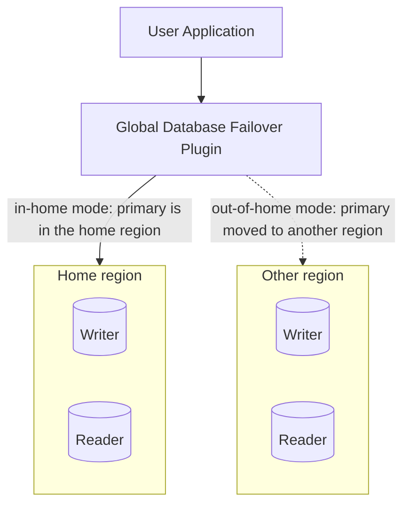

In an [Amazon Aurora Global Database](https://docs.aws.amazon.com/AmazonRDS/latest/AuroraUserGuide/aurora-global-database.html),
the primary DB cluster in one AWS region is replicated to secondary clusters in
other regions. The Global Database (GDB) Failover Plugin extends failover with
awareness of these regions so it can reconnect with minimal downtime when the
primary region changes.

The plugin introduces the notion of a **home region** and lets you configure
different failover logic for the **in-home** case (the Global Database primary
region is the home region) and the **out-of-home** case (the primary region is
not the home region). For example, an application can follow the writer while
the primary is local but connect to a nearby reader once the primary moves to
another region.


:::info Available since
Version 1.0.0
:::



*The plugin compares the Global Database's current primary region with the configured home region. While they match, the **in-home** mode selects the failover target; once the primary moves to another region, the **out-of-home** mode applies instead.*

## How to enable

The plugin is not enabled by default. Add the plugin code `gdb_failover` to the `wrapper_plugins` parameter. After the plugin is loaded, the failover feature is enabled.

```ruby
conn = AwsAdvancedRubyDriverWrapper::WrapperPgConnection.new(
  host: "my-cluster.cluster-xyz.us-west-1.rds.amazonaws.com",
  dbname: "mydb",
  wrapper_plugins: "gdb_failover",
  failover_home_region: "us-west-1"
)

```

:::warning
Only one failover plugin may be enabled per connection. Do not use `gdb_failover` together with the other `failover` plugin at the same time for the same connection.
:::

## Configuration parameters

| Parameter | Type | Required | Default | Description |
|-----------|------|----------|---------|-------------|
| `failover_home_region` | String | Yes for endpoints with no region; otherwise No | parsed from URL | The AWS region the application runs in. Determines which of the in-home and out-of-home modes applies. Defaults to the region parsed from the connection endpoint, and is required when the endpoint carries no region (a Global Database endpoint, an IP address, or a custom domain).<br/><br/>Example: `us-west-1` |
| `in_home_failover_mode` | String | No | depends on URL | Failover mode used while the Global Database primary region **is** the home region. Values include `strict_writer`, `home_reader_or_writer`, `strict_home_reader`, `strict_out_of_home_reader`, `strict_any_reader`, `out_of_home_reader_or_writer`, and `any_reader_or_writer`.<br/><br/>Example: `strict_writer` |
| `out_of_home_failover_mode` | String | No | depends on URL | Failover mode used while the Global Database primary region **is not** the home region. Accepts the same values as the in-home mode.<br/><br/>Example: `strict_any_reader` |
| `global_cluster_instance_host_patterns` | String | Yes for Global Databases; otherwise No | none | Comma-separated instance host patterns for every Global Database region. Prefix custom-domain patterns with `[region]`. Required for Aurora Global Databases; ignored otherwise.<br/><br/>Example: `?.xyz1.us-east-1.rds.amazonaws.com,?.xyz2.us-west-1.rds.amazonaws.com` |
| `cluster_instance_host_pattern` | String | Yes for IP/custom domains; otherwise No | auto-derived | DNS pattern used to build instance endpoints when the connection host is not a recognizable RDS endpoint. Use `?` as the instance identifier placeholder.<br/><br/>Example: `?.customHost` |
| `accessible_regions` | String | No | all regions | Comma-separated list of AWS regions the application can reach. When set, failover and topology monitoring only consider nodes in these regions. If the home region is also set, it must be included.<br/><br/>Example: `us-east-1,us-west-1` |
| `failover_timeout_sec` | Float | No | `300.0` | Maximum allowed time to attempt reconnecting to a new writer or reader instance after a cluster failover is initiated. *(s)*<br/><br/>Example: `300.0` |
| `cluster_topology_refresh_rate_sec` | Float | No | `5.0` | Cluster topology refresh rate while the cluster is not in failover (the regular slow monitoring rate). *(s)*<br/><br/>Example: `5.0` |
| `failover_reader_host_selector_strategy` | String | No | `random` | Strategy used to select a reader node during failover. See [host selection strategies](../host-selection-strategies) for the available values.<br/><br/>Example: `random` |

## Configuration examples

### Writer connection with in-region failover

**Goal:** An application deployed in `us-west-1` needs a writer connection to a global database spanning `us-east-1`, `us-west-1`, and `us-east-2`.

**Solution:** configure the following:

- `failover_home_region: us-west-1` — required here, because a global endpoint carries no region for the wrapper to parse
- `in_home_failover_mode: strict_writer` and `out_of_home_failover_mode: strict_writer` — always reconnect to the writer, wherever the primary region currently is
- `global_cluster_instance_host_patterns` — one pattern per region, so the wrapper can reach individual instances
- `wrapper_dialect: global-aurora-pg` (or `global-aurora-mysql`)
- `wrapper_plugins: initial_connection,gdb_failover`
- point `host` at the global database endpoint

```yaml
# config/database.yml
production:
  adapter: aws_postgresql
  host: my-global-db.global-xyz.global.rds.amazonaws.com
  database: mydb
  username: <username>
  password: <password>
  wrapper_plugins: initial_connection,gdb_failover
  wrapper_dialect: global-aurora-pg
  failover_home_region: us-west-1
  in_home_failover_mode: strict_writer
  out_of_home_failover_mode: strict_writer
  global_cluster_instance_host_patterns: "?.xyz1.us-east-1.rds.amazonaws.com,?.xyz2.us-west-1.rds.amazonaws.com,?.xyz3.us-east-2.rds.amazonaws.com"
```

Both modes are `strict_writer`, so a switchover to another region still leaves this connection on a writer. Writes then cross regions, which costs latency — that is the trade this configuration makes to keep writes working.

### Prefer a home-region reader on cross-region failover

**Goal:** A reporting connection in `us-west-1` should read locally, and should keep preferring `us-west-1` readers even after the primary region switches over.

**Solution:** configure the following:

- `failover_home_region: us-west-1` — optional here, since a regional reader endpoint already carries the region, but stating it keeps the intent explicit
- `in_home_failover_mode: strict_home_reader` and `out_of_home_failover_mode: strict_home_reader` — stay on a reader in the home region either way
- `global_cluster_instance_host_patterns` and `wrapper_dialect` — same as above
- `wrapper_plugins: initial_connection,gdb_failover`
- point `host` at the cluster reader endpoint in `us-west-1`

```yaml
# config/database.yml
production:
  adapter: aws_postgresql
  host: my-cluster.cluster-ro-xyz2.us-west-1.rds.amazonaws.com
  database: mydb
  username: <username>
  password: <password>
  wrapper_plugins: initial_connection,gdb_failover
  wrapper_dialect: global-aurora-pg
  failover_home_region: us-west-1
  in_home_failover_mode: strict_home_reader
  out_of_home_failover_mode: strict_home_reader
  global_cluster_instance_host_patterns: "?.xyz1.us-east-1.rds.amazonaws.com,?.xyz2.us-west-1.rds.amazonaws.com,?.xyz3.us-east-2.rds.amazonaws.com"
```

This is the entry to use as the `reading` role when you pair it with a writer through `connects_to`. Reads never leave `us-west-1`, so this connection cannot write — pair it with a writer configuration for anything that does.

