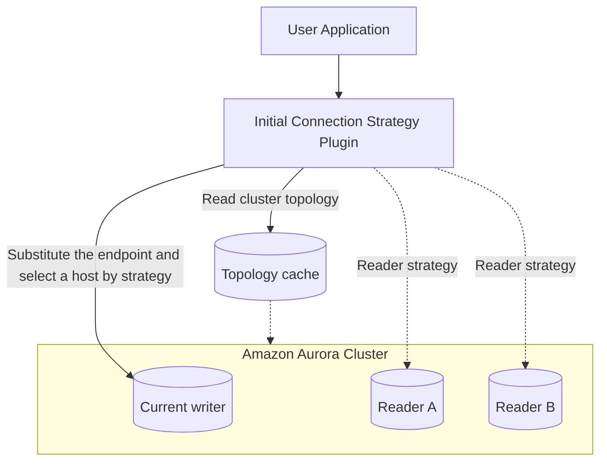

The Initial Connection Strategy Plugin controls how the initial connection to a
cluster is established and verified, and it obtains a connection more reliably
while DNS is updating. When the initial connection is to a reader or custom
cluster endpoint, the connected host is chosen according to the configured
[host selection strategy](../host-selection-strategies).

When you connect to a cluster endpoint, the instance for a new connection is
resolved by DNS. During failover the cluster elects another instance to be the
writer, and while DNS is updating — which can take up to 40–60 seconds — a
connection to the cluster endpoint may land on an old node. This plugin helps
by replacing the outdated endpoint while DNS is updating. It also recognizes an
Aurora Global Writer Endpoint and substitutes it with the current writer
endpoint.

This plugin is part of the default plugin list as of v1.0.0: it resolves a cluster
endpoint to a specific instance and distributes new connections across the
cluster's instances. On an Aurora custom endpoint it passes the endpoint through
unchanged unless `initial_connection_substitute_host` is set to `any` or `reader`.
It does not apply where there is no cluster endpoint to resolve (for example
behind an RDS Proxy), and should be left out there.


:::info Available since
Version 1.0.0 (default plugin)
:::



*Instead of relying on the DNS-resolved cluster endpoint — which can point at a stale node while DNS updates after failover — the plugin reads the topology and selects a host that matches the requested role, using the configured host selection strategy when several hosts match.*

## How to enable

Add the plugin code `initial_connection` to the `wrapper_plugins` parameter.

```ruby
conn = AwsAdvancedRubyDriverWrapper::WrapperPgConnection.new(
  host: "my-cluster.cluster-ro-xyz.us-east-1.rds.amazonaws.com",
  dbname: "mydb",
  wrapper_plugins: "initial_connection"
)

```

Verify plugin compatibility within your Ruby configuration using the [compatibility guide](../compatibility).

## Configuration parameters

| Parameter | Type | Required | Default | Description |
|-----------|------|----------|---------|-------------|
| `initial_connection_substitute_host` | String | No | depends on endpoint type | Whether the initial connection URL should be replaced with an instance URL from the topology when available, and the role of the instance to select. For writer or global writer endpoints, valid values are `writer` and `none`; for reader endpoints, `reader` and `none`; for custom cluster endpoints with the custom endpoint plugin enabled, `any`, `reader`, or `none`. `none` disables substitution. When unset, the default is derived from the endpoint type: a writer or global writer cluster endpoint substitutes a `writer`, a reader cluster endpoint substitutes a `reader`, and any other endpoint (instance, custom, or non-RDS) performs no substitution.<br/><br/>Example: `reader` |
| `initial_connection_verify_role` | String | No | depends on endpoint type | Whether an opened connection should be verified to be a writer or reader after connecting, or if no role verification should be performed. `none` disables verification. When unset, the default is derived from the endpoint type: a writer or global writer cluster endpoint verifies `writer`, a reader cluster endpoint verifies `reader`, and any other endpoint performs no verification.<br/><br/>Example: `reader` |
| `initial_connection_host_selector_strategy` | String | No | `random` | Strategy used to select a host when opening a new connection, applied after the substitution role narrows the candidates. See [host selection strategies](../host-selection-strategies) for the available values.<br/><br/>Example: `random` |
| `initial_connection_retry_timeout_sec` | Float | No | `30.0` | Maximum allowed time for retries when opening a connection. *(sec)*<br/><br/>Example: `40.0` |
| `initial_connection_retry_interval_sec` | Float | No | `1.0` | The time between retries when opening a connection. *(sec)*<br/><br/>Example: `2.0` |
| `initial_connection_wait_for_topology_sec` | Float | No | `0.0` | Maximum allowed time to wait for the cluster topology to be fetched before opening a new connection. When greater than `0` and topology is not yet available, the plugin blocks until topology is discovered (or the timeout is reached) rather than falling back to the cluster endpoint. This helps host selection strategies distribute concurrent and pool-prefill connections across instances. A value of `0` means the plugin will not wait for topology information if it is not yet available and may occasionally use the cluster endpoint in these scenarios. *(sec)*<br/><br/>Example: `30.0` |
| `initial_connection_inactive_substitute_host` | String | No | passthrough | Whether an inactive cluster writer endpoint in the initial connection URL should be replaced with a writer instance URL from the topology when available. Applicable to Aurora Global Databases. Valid values are `writer` and `none`.<br/><br/>Example: `writer` |
| `initial_connection_inactive_verify_role` | String | No | writer if a writer was substituted; otherwise none | Whether a connection opened with an inactive cluster writer endpoint should be verified to be a writer. Applicable to Aurora Global Databases. Valid values are `writer` and `none`. When unset, the connection is verified to be a writer only if the endpoint was substituted with a writer instance; otherwise no verification is performed.<br/><br/>Example: `writer` |
| `accessible_regions` | String | No | all regions | Comma-separated list of AWS regions the application can reach. Applicable to Aurora Global Databases, the only deployment whose instances span multiple regions. When set, candidate hosts in regions not listed are excluded before host selection.<br/><br/>Example: `us-east-1,us-west-1` |
